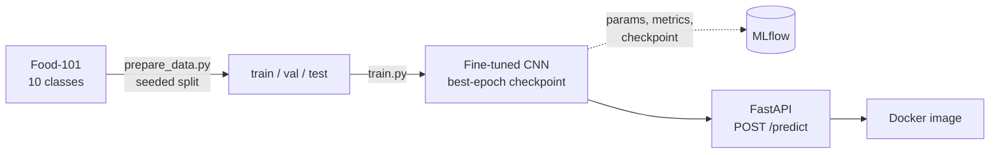

# Food Recognition Service

An end-to-end image classification service. Upload a photo of a dish and get back its name and a confidence score.

The model is the easy part. This project is about the engineering around it: reproducible data splits, tracked experiments, a tested REST API, Docker packaging and, next, model compression and production-style serving. Everything is trained and run on a laptop GPU (RTX 3050, 4 GB VRAM).

**Status:** work in progress. Training and experiment tracking are done; test-set evaluation and model compression are next. See the [roadmap](#roadmap).

## Results so far

Four ImageNet-pretrained CNNs fine-tuned on 10 Food-101 classes for 10 epochs each, tracked in MLflow:

| Model | Parameters | Learning rate | Batch size | Validation accuracy | Peak VRAM (MB) | Time per epoch |
|---|---:|---:|---:|---:|---:|---:|
| ConvNeXt-Tiny | 27.8 M | 1e-4 | 16 | **95.0%** | 1,339 | 105 s |
| MobileNetV3-Large | 4.2 M | 1e-3 | 32 | 94.0% | 783 | 63 s |
| ResNet-50 | 23.5 M | 3e-4 | 16 | 93.1% | 1,022 | 98 s |
| ResNet-18 | 11.2 M | 3e-4 | 32 | 92.1% | 555 | 65 s |

What the table shows, and what it doesn't:

- **These are validation numbers.** The test set (2,500 images) is kept untouched for the final evaluation, which comes next.
- **MobileNetV3 is the best size-to-accuracy trade-off:** 1 point behind ConvNeXt with 6.6× fewer parameters. That makes it the student for the distillation step.
- **Each model ran once, with its own learning rate and batch size.** The validation set has 1,500 images, so one point is 15 images. Differences of about a point may be noise.
- **Training is limited by data loading, not the GPU.** ResNet-18 and MobileNetV3 take the same ~64 s per epoch despite very different compute. JPEG decoding and augmentation on the CPU are the bottleneck.

## How it works



### Data

10 classes from [Food-101](https://data.vision.ee.ethz.ch/cvl/datasets_extra/food-101/): pho, spring rolls, fried rice, dumplings, ramen, sushi, pizza, hamburger, steak and ice cream.

| Split | Per class | Total | Source |
|---|---:|---:|---|
| Train | 600 | 6,000 | Food-101 train list |
| Validation | 150 | 1,500 | Food-101 train list, held out with a fixed seed |
| Test | 250 | 2,500 | Food-101 test list, used only for the final evaluation |

### Training

- Transfer learning: replace the ImageNet classification head, then fine-tune the whole network.
- AdamW, 1 epoch of linear warmup then cosine decay, stepped every batch.
- Mixed precision (AMP) to fit larger models in 4 GB of VRAM.
- Label smoothing 0.1 in the training loss. Validation loss uses plain cross-entropy, so it stays comparable between runs with different smoothing.
- Only the best epoch is saved, not the last one.

### Serving

- `GET /health` and `POST /predict`, built with FastAPI.
- The model loads once, on the first request.
- A file that isn't an image gets a 400 error, not a 500.

## Design decisions

- **One preprocessing function for evaluation and serving.** `eval_transform` in `model.py` is used by both, so the API can't drift from what the model was validated on.
- **Checkpoints carry their own metadata.** Each one stores the architecture name and class list, so the API can serve any of the four models by changing `MODEL_PATH`, without a code change.
- **Reproducible split.** `prepare_data.py` uses a fixed seed and samples per class, so every run gets the same balanced split.
- **The test set is not used to choose models.** Validation picks the model; the test set is touched once at the end. Otherwise the reported accuracy would be optimistic.
- **Tests don't need model weights.** The predictor is injected with FastAPI's `Depends`, so tests swap in a fake one. They run in seconds and need no GPU and no model file.
- **Pinned, platform-aware PyTorch.** uv installs CUDA wheels on Windows for training and CPU wheels on Linux for the Docker image, from one lockfile.
- **Cache-friendly Docker image.** Dependencies install in their own layer, so changing code doesn't reinstall PyTorch. Model weights are mounted at runtime, not baked into the image.
- **Git Flow.** Feature branches go into `develop` through pull requests; releases go into a protected `main` and are tagged (`v0.1.0`). Commits follow Conventional Commits, and pre-commit runs ruff before each one.

### Known limitations

- **It always answers with one of 10 dishes.** It's a closed-set classifier: a photo of a dish it was never trained on, such as bánh cuốn, still gets one of the 10 labels, sometimes with high confidence. Detecting out-of-distribution inputs is a possible later step.
- **Confidence scores aren't calibrated.** A confidence of 0.9 doesn't yet mean "right 90% of the time".

## Quickstart

Requires [uv](https://docs.astral.sh/uv/) and Python 3.12. An NVIDIA GPU is optional for training and not needed for serving.

```bash
# Install dependencies (CUDA build of PyTorch on Windows, CPU build on Linux)
uv sync

# Download Food-101 (~5 GB) and build the 10-class split in data/processed/food10
uv run python scripts/prepare_data.py

# Train; see `--help` for every option
uv run python -m food_recognition.train --arch mobilenet_v3_large --lr 1e-3

# Browse runs at http://127.0.0.1:5000
uv run mlflow ui --backend-store-uri sqlite:///mlflow.db
```

Serve a trained model:

```bash
# Uses models/resnet18_food10.pt by default; set MODEL_PATH to serve another checkpoint
uv run uvicorn food_recognition.api:app --port 8000

# In another terminal (on Windows PowerShell, use curl.exe)
curl -F "file=@my_photo.jpg" http://127.0.0.1:8000/predict
# -> {"label": "<class name>", "confidence": <0 to 1>}
```

With Docker:

```bash
docker build -t food-recognition .
docker run --rm -p 8000:8000 -v "$(pwd)/models:/app/models" \
  -e MODEL_PATH=/app/models/mobilenet_v3_large_food10.pt food-recognition
```

Run the checks:

```bash
uv run pytest
uv run ruff check .
```

## Project structure

```
src/food_recognition/
  config.py        paths and settings, overridable by environment variables
  model.py         model registry, shared preprocessing, Predictor
  train.py         training loop with MLflow tracking
  api.py           FastAPI app
scripts/
  prepare_data.py  builds the train / val / test split
tests/             API tests
Dockerfile
```

## Roadmap

- [x] **Walking skeleton (v0.1.0):** fine-tuned ResNet-18 behind a FastAPI endpoint, with tests and Docker.
- [x] **Experiment tracking:** four architectures trained and compared in MLflow.
- [ ] **Evaluation:** test-set accuracy, confusion matrix and per-class metrics; register the chosen model in the MLflow Model Registry.
- [ ] **Compression:** distill a larger teacher (ConvNeXt-Tiny or ResNet-50) into MobileNetV3, then pruning and INT8 quantization with ONNX Runtime and TensorRT. Report accuracy, size and latency for every version.
- [ ] **Serving:** NVIDIA Triton Inference Server with dynamic batching, behind a FastAPI gateway (REST and gRPC). Load tests with `perf_analyzer` and Locust.
- [ ] **Hardening:** authentication, rate limiting, upload size and image dimension limits, structured logs and Prometheus metrics.
- [ ] **Deployment:** docker-compose and Kubernetes with autoscaling; GitHub Actions for lint, tests, image builds and a security scan.

## Tech stack

Python 3.12 · PyTorch · torchvision · FastAPI · MLflow · Docker · uv · pytest · ruff · pre-commit

## Acknowledgements

Dataset: Bossard, Guillaumin and Van Gool, *Food-101: Mining Discriminative Components with Random Forests*, ECCV 2014.
